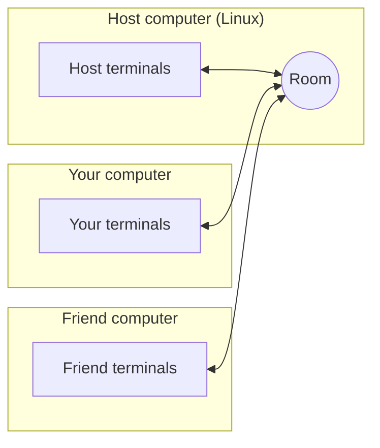

# Seer

Share live terminals with your friends. Each person runs their own
terminals on their own computer.

https://github.com/user-attachments/assets/cb75450e-8e4e-4e32-93b7-e37482a9cd55

## How it works

One person hosts a room. Friends join with one pasted line. Everyone
can watch the terminals of everyone else. You choose who can type in
yours.

- Your terminals use your own files, tools, and logins.
- The room only moves screens and keys. Pick a host you trust.
- Your terminals keep running if you close Seer or lose the room.
- Linux and macOS. Version 0.6.0.

## Install

    curl -fsSL https://raw.githubusercontent.com/nethum529/seer-releases/main/install.sh | sh

- macOS: open Seer from Launchpad or Spotlight.
- Linux x86_64: open Seer from your app list. It needs glibc 2.35 or
  newer.
- The installer also adds the `seer` command. It does not need sudo.

## Host a room

You can host on Linux only. In Seer, select Start a room, or run
`seer start`.

To invite a friend, open the room menu and select Invite a person.
Send them the line. A line works one time and expires after 1 hour.
Keep it secret like a password.

## Join a room

In Seer, select Join a room and paste the line. You can also paste it
in a terminal. A friend without Seer gets a line that installs Seer
and joins in one step.

## Use Seer

- Select a person to watch their live terminals.
- Type in your own terminal as usual. All keys go to it.
- To let a person type in your terminals, open their menu and turn on
  Share control. It is for that person only. They cannot open, close,
  or resize your terminals.
- To let everyone type, open the room menu and select Share control
  with everyone. Stop sharing control ends it for all.
- The host can remove a person from that person's menu.

## Commands

The app does most things. Use the `seer` command to start, join, and
manage a room. Run `seer help` for the full list.

- `seer start` starts a new room. `seer start --restore` opens the
  last room again.
- `seer invite --hours 24` makes a join line that lasts 24 hours
  (1 to 168).
- `seer join <line>` joins a room.
- `seer perms --on` lets everyone in the room now type in your
  terminals. `seer perms --off` stops it.
- `seer leave` leaves the room.
- `seer remove <person>` and `seer stop` are for the host only.
- `seer update` installs the latest version. Everyone in a room must
  use the same version.

## More

- [How Seer works](docs/architecture.md)
- [Safe connections](docs/adr/0002-builtin-connect.md): a join line
  opens the room and nothing else on the host computer.
- [Install and update details](docs/adr/0011-desktop-install-and-update.md)
- [Build from source](docs/development.md) and
  [contribute](CONTRIBUTING.md)
